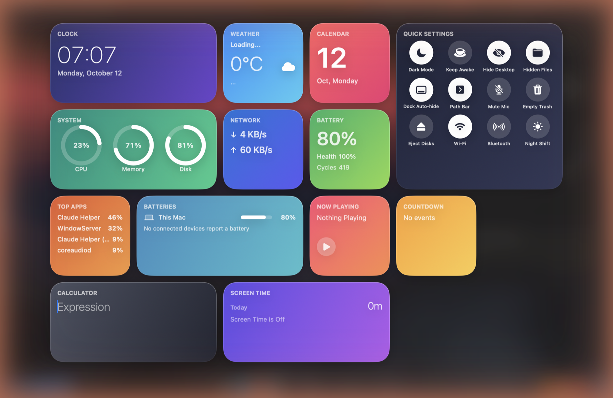

<div align="center">


# KatiKati

**macOS 的逐窗口任务栏，自带应用启动台、小组件 Pinboard 和快捷开关。**

*katikati* 在斯瓦希里语里是“正中间”的意思。

[English](README.md) · 中文

[下载测试版](https://github.com/wakilibaraka/KatiKati/releases/latest) · [反馈问题](https://github.com/wakilibaraka/KatiKati/issues/new/choose) · [更新日志](CHANGELOG.md)

</div>

---


> **测试版。** 0.17.0 beta 2 未签名、未公证，见[安装](#安装)。部分新界面尚未在真实触控板和多显示器上充分验证，所有新增翻译均为待审校的草稿，可能有粗糙之处。
>
> *本中文页为英文 README 的翻译草稿，以英文版为准。*

## 这是什么

KatiKati 在 Mac 屏幕底部放一条悬浮栏。每个窗口都有自己的卡片，想回到“那个窗口”，扫一眼点一下就行，不用再搜。栏的周围还有启动台、一页实时小组件和一组快捷开关，全部用原生 Swift 编写。

KatiKati 是 [Tungsten Edge](https://github.com/moonbai-studio/tungsten-edge) 的分支，沿用了它的窗口追踪核心，见[致谢](#致谢)。

## 功能

### 任务栏

- **一窗口一卡片。** 多窗口应用会拆成多张卡片，单窗口应用保持紧凑。点击即可切换、最小化或恢复。
- **卡片状态一眼可辨。** 标题变灰表示窗口已最小化或所属应用被隐藏；其他空间（Space）里的窗口仍会列出，点击会带你过去。
- **五种布局。** 全宽、Split 3、Split 4、Split 5、居中，可调栏高、间距、边距和组件宽度（设置 > 布局）。
- **栏上的岛屿组件。** 天气、正在播放和时钟；点时钟打开日历面板，点天气打开预报面板。天气会请求定位服务（或使用你搜索的城市），并为每个地点保存最近一次预报最多 7 天，离线时仍可查看。
- **入门应用。** 全新安装时，栏上会保留访达、Safari、系统设置和信息，第一次打开不会是空的。
- **应用抽屉、搁板、废纸篓和固定文件夹。** 拖动卡片排序，把应用收进抽屉，把文件拖到搁板上。
- **边缘抽屉。** 屏幕左右边缘的窄抽屉里有：备忘录（静态加密）、提醒事项、闹钟、计时器与秒表、任务、剪贴板历史（需手动开启）、截取（识别屏幕区域内的文字和二维码）、窗口（吸附到分区）、屏幕使用时间、天气、正在播放、蓝牙和系统监视器。
- **多显示器。** 一条栏跟随鼠标，或每块屏幕各一条，每条只列出本屏的窗口。
- **自动隐藏。** 默认常驻；也可以隐藏并从屏幕底边唤出。`⌥⇧⌘D` 切换。
- **全屏无闪烁。** 进入原生全屏前，栏会先让开（见[隐私](#隐私)）。

### 启动台


- **一个应用网格，每行 8 个图标。** 先是**常用**一行（你真正启动过的应用；历史不够时，由系统设置、Safari、终端、信息、访达、邮件和日历补位），然后是**最近安装**，最后是**全部应用**。搜索框在顶部，也可放到任意一边。
- **滑动翻页。** 轻扫、滚动、按方向键或点圆点切换页面；也可改为向下滚动的单页（设置 > 布局 > 启动台）。
- **按你的方式整理。** 在“全部应用”里拖动图标重新排序。右键点应用可打开、在访达中显示、拷贝路径、固定、移到最前或从启动台隐藏（隐藏的应用仍能被搜索到）。设置里会显示隐藏数量，可一键全部显示或重置顺序。
- **多种打开方式。** 栏左侧的按钮、`⌥Space`，或触控板四指捏合（默认关闭，见[快捷键与手势](#快捷键与手势)）。
- **主题。** 系统、浅色、深色、玻璃或桌面图片，可加色调，有三种图标样式。

### Pinboard 与快捷设置



Pinboard 是一页一眼可读的卡片，从栏右端的按钮或 `⌃⌥Space` 打开。可全屏铺开（默认）或作为浮动面板，显示哪些卡片由你决定。

- **卡片：** 时钟、日历、天气、正在播放、计算器、倒计时、屏幕使用时间（需手动开启）、系统（CPU、内存、磁盘）、网络、电池（含健康度和循环次数）、占用最高的应用、电量（你的 Mac 和已连接的蓝牙设备）以及快捷设置。
- **快捷设置**有 12 个开关：深色模式、保持唤醒、隐藏桌面图标、显示隐藏文件、Dock 自动隐藏、路径栏、麦克风静音、清倒废纸篓（会先确认）、推出磁盘、Wi-Fi、蓝牙和夜览。蓝牙和夜览依赖 macOS 未公开的系统接口，系统更新后可能失效，失效时静默处理。
- 不显示 iPad、Apple Watch 和 iPhone 的电量：macOS 没有向 Mac 开放这些数据。

### 快捷键与手势

| 动作 | 默认 | 备选 |
|---|---|---|
| 打开启动台 | `⌥Space` | `⌃Space`、`⌥⇧Space`、`⌃⇧Space`、`⌃⌥Space`，或双击 `⌘`、`⌃`、`⌥` |
| 打开 Pinboard | `⌃⌥Space` | 同上 |
| 仅快捷设置 | 关 | 同上 |
| 保持唤醒开/关 | 关 | 同上（会弹出简短提示） |
| 显示/隐藏栏 | `⌥⇧⌘D` | 在设置 > 通用中重新绑定 |
| 捏合打开启动台 | 关 | 触控板上四指或更多手指捏合 |

双击快捷键需要辅助功能权限。捏合手势通过 macOS 未公开的接口读取触控板原始触点，无需任何权限。macOS 自带一个四指捏合手势（启动台 Launchpad）会打开系统的应用列表，使用前请在“系统设置 > 触控板 > 更多手势”中关闭 **启动台**。`⌃Space` 也可能与 macOS 的输入法切换快捷键冲突。

### 没有辅助功能权限也能用

KatiKati 在你授予辅助功能之前也能启动。这种*有限模式*下，栏、边缘抽屉、启动台、Pinboard 和快捷键都可用；需要辅助功能的只是读取和管理其他应用的窗口（逐窗口卡片）。状态栏菜单会显示 **授予辅助功能以获得完整功能…**；授权后 KatiKati 会自动重启进入完整模式。

### 语言

界面跟随系统语言，共 12 个本地化：English、简体中文、繁體中文、日本語、Deutsch、Français、Español（西班牙与拉丁美洲）、Português（巴西与葡萄牙）、Italiano 和 한국어。在设置 > 通用 > 语言中更改。

## 安装

系统要求：macOS 12（Monterey）及以上，Intel 与 Apple 芯片均可（通用二进制）。

1. 从[最新发布](https://github.com/wakilibaraka/KatiKati/releases/latest)下载 `KatiKati-0.17.0-beta.2.dmg`。
2. 打开磁盘映像，把 **KatiKati** 拖到 **应用程序**。
3. 测试版未经公证，首次启动请**右键点击 KatiKati，选择“打开”**，然后确认。
4. 可选：授予**辅助功能**（系统设置 > 隐私与安全性 > 辅助功能）以启用逐窗口卡片。每个新的未签名版本可能需要重新授权。

应用内更新源已上线，但目前还没有任何发布条目，所以测试版通过发布页分发：请到那里下载新版本。

想从源码构建，见[开发者](#开发者)。

## 推荐的 Dock 设置

KatiKati 的设计是取代屏幕底部的 Dock。首次运行时它会给出三个勾选项，一键应用：隐藏 Dock、使用“缩放”最小化效果、把窗口最小化到应用图标。想手动设置，打开系统设置 > 桌面与程序坞：

- **屏幕上的位置**设为**底部**，并开启**自动显示和隐藏程序坞**（否则最小化动画会飞向侧边或顶部的 Dock）；
- **使用以下效果最小化窗口**设为**缩放效果**；
- 开启**将窗口最小化为应用程序图标**。

想让 Dock 彻底不再出现，把 KatiKati 状态栏菜单里的 **The Dock** 滑块拖到 `Never Wake`。

## 状态栏菜单与设置

**状态栏菜单**（菜单栏里的胶囊图标）放的是会话中常调的项：登录时打开、栏的唤醒延迟、Dock 的唤醒延迟、任务栏大小、布局子菜单、显示搁板、显示废纸篓、悬停显示应用名、让最大化窗口保持在任务栏之上、程序坞设置和设置。接了两块或更多显示器时还会出现单屏/多屏模式。

**设置窗口**有五个标签页：


- **通用：** 语言、外观（系统、浅色、深色）、显示/隐藏快捷键、小组件布局与颜色、时钟样式、单位、天气选项、正在播放主题、抽屉位置、反转鼠标滚轮方向和新手引导。
- **布局：** 布局模式与尺寸、底边、边缘抽屉，以及启动台、Pinboard 和快捷键三个部分。
- **外观：** 栏的主题（自动、半透明、水晶、黑曜石、极光、深海等）、图标集、自定义色调和不透明度。
- **高级：** 预判全屏切换。
- **关于：** 版本、检查更新，以及 **诊断信息**（复制应用、系统和显示器信息，方便粘贴到 GitHub issue）。

## 隐私

KatiKati 没有账号、没有统计分析，也没有反馈表单，不会把你的数据发到任何地方。涉及网络或系统的有：

- **检查更新。** Sparkle 按计划检查更新源（可在设置 > 关于中关闭）。更新源托管在 GitHub Pages，目前还没有任何发布条目，所以检查不到任何内容。
- **天气。** 天气小组件会为你的位置（需你允许）或你搜索的城市请求预报。
- **为全屏无闪烁监听输入。** 为了在原生全屏切换*之前*藏起栏，KatiKati 观察全局的左键点击、按键和触控板手势事件，只识别四种：窗口绿灯、`Control-Command-F`、切到相邻全屏空间的 `Control-Left`/`Control-Right`，以及三指横扫。其他输入不记录、不写日志、不外发。在设置 > 高级中关闭**预判全屏切换**即可完全关闭监听。
- **反转鼠标滚轮方向**（默认关闭）会增加第二个事件监听，只翻转离散鼠标滚轮事件的方向，且仅在开关打开期间运行。
- **屏幕使用时间**（默认关闭）只记录哪个普通应用在最前、持续多久，保存在本机，保留 90 天；从不记录窗口标题、文档、按键或截屏。“删除屏幕使用时间数据”可清空。
- **蓝牙。** 蓝牙开关第一次读取电源状态时，会请求 macOS 的蓝牙权限。

当安全输入（例如密码框）生效时，macOS 会屏蔽事件监听收到的按键事件，此时全屏预判的快捷键无法识别；绿灯和手势检测不受影响。

## 致谢

KatiKati 基于 Moonbai Studio 的 [Tungsten Edge](https://github.com/moonbai-studio/tungsten-edge)（GPL-3.0-or-later）：窗口追踪引擎、栏渲染、面板协调和基线测试套件。它还使用了 SplitBar-old 与 DockBar（均为 MIT）的思路和代码，并参考了 [noty](https://github.com/aimen08/noty) 和 EdgeDeckBar。完整声明见 [NOTICE](NOTICE)。

## 许可证

KatiKati 以 GNU 通用公共许可证 v3.0 或更高版本（`GPL-3.0-or-later`）授权，见 [LICENSE](LICENSE) 和 [NOTICE](NOTICE)。“Tungsten Edge”“钨极”及其标志属于 Moonbai Studio，本项目不使用，见 [TRADEMARK.md](TRADEMARK.md)。代码签名证书、公证凭据等机密从不进入本仓库。

---

## 开发者

各版本的发布说明在 [`Docs/Releases/`](Docs/Releases)；决策与切片的流水记录在 [`HYBRID_PLAN.md`](HYBRID_PLAN.md)，工作规则在 [`STANDING_RULES.md`](STANDING_RULES.md)。

**构建并运行**（结束已运行的实例、构建 Debug、重新签名、启动；不要单独跑 `xcodebuild` 再 `open`，因为辅助功能授权跟随签名身份）：

```bash
./Scripts/build_and_run.sh          # 日常开发
./Scripts/build_and_run.sh --lab    # 窗口实验室诊断命令行
```

**测试**（约 1,900 个 XCTest 用例；CI 每次推送运行同样的命令）：

```bash
xcodebuild test -project KatiKati.xcodeproj -scheme KatiKati \
  -derivedDataPath build/DerivedData -destination 'platform=macOS' CODE_SIGNING_ALLOWED=NO
python3 Scripts/check_localization.py     # 每条本地化字符串在 12 种语言里都有值
python3 Scripts/check_debug_switches.py   # 每个 DOCK_* 环境开关都已登记
```

**代码结构**（一个 Xcode target，四个只向下依赖的目录）：

| 目录 | 内容 | 经验法则 |
|---|---|---|
| `Core/` | 纯决策：窗口识别、布局、排版打包、快捷键、启动台排序、捏合检测 | 不引入 AppKit 和辅助功能；能写成“事实的纯函数”的行为放这里并配单元测试。 |
| `Platform/` | 系统适配：辅助功能、CoreGraphics 窗口列表、事件监听、启动台索引器、Pinboard 读取器和快捷开关引擎 | 与 macOS 交互，把事实交给 Core。 |
| `App/` | 组合与界面：`AppDelegate`、面板控制器、SwiftUI 场景，以及把设置存进 `UserDefaults` 的 `…Store` 类 | 大类型按 `Type+Topic.swift` 拆成扩展。 |
| `Tools/WindowLab/` | 窗口识别场景的回放命令行 | 不属于发布的应用。 |

**发布。** Xcode 工程有意使用本地证书签名；Developer ID 签名、公证和打包在维护者机器上由 `Scripts/package_release.sh` 完成。测试版可以用 Release 的 `xcodebuild` 加 `hdiutil` 生成未签名安装包，本次 beta 即如此。

**贡献。** 超出小修的改动请先开 issue。英文是源语言，新增面向用户的字符串必须在 12 种本地化里都有值（否则 `Scripts/check_localization.py` 会失败）。代码注释大多为中文，沿袭自上游项目；如果某处读不懂，请开 issue 指明文件。
